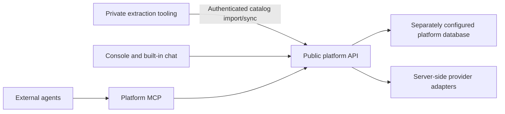

# Repository boundary and provenance

The public platform starts from a file allowlist exported on 2026-10-26 at source revision `df0f37dd1de1ef8fe6a4f23e7ae9e0562ba12ac1`. This includes the pre-existing delegated organization-access fix. [baseline.json](baseline.json) records the selected paths and relocated files. No source Git history, branches or tags were imported. The fresh root commit and `hackathon-start` tag identify existing work, not work newly completed during the event.

The baseline includes the platform API, console/chat, action contracts, database schema, permissions, localization-job orchestration, billing foundations, design system, tests and selected product/architecture documents. The public packaging adds standalone client/MCP packages, synthetic input, independent CI and setup documentation.

The generic HTTP client was relocated from the private CLI package. The platform tool adapter was relocated from the mixed MCP server. Those files contain no extraction implementation. Imports now resolve only to public workspaces. All packages are private to npm; this repository does not publish packages automatically.

Excluded: extraction engine and prompts, AST/framework adapters, runtime generation, local extraction/translation MCP implementation, editor extension, benchmark corpora, marketing app, customer catalogs, local environment files, cloud configuration, generated bundles, private package archives and deployment workflows. The original private repo remains unchanged.

## How the two projects cooperate

The public project runs from synthetic catalogs without extraction tooling. Private extraction can be an optional external producer; it must not become a build/install dependency or an undisclosed prerequisite for the hackathon demonstration. Provider-based context enrichment and translation can operate on imported source content and metadata. Publishing that capability does not require publishing the source parser/extractor.

Use this repo for hackathon platform changes. Transfer reviewed platform fixes back into the private product as scoped patches. Never merge private history into this repository. Keep infrastructure, credentials, deployment targets and databases separate. Do not copy private CI files or grant this repo production secrets.

`npm run check:public` guards the package/dependency boundary and scans for common credential signatures, generated artifacts and deployment endpoints. Review the staged diff too; this guard cannot prove arbitrary new content is safe to publish. Run it before every push. No additional files should be exported from the private source without reviewing their content.

The commercial LICENSE is preserved verbatim at the owner's direction. No open-source grant is implied. Font licenses remain with their assets. Any later change to licensing or hackathon submission declarations needs a deliberate separate decision.
