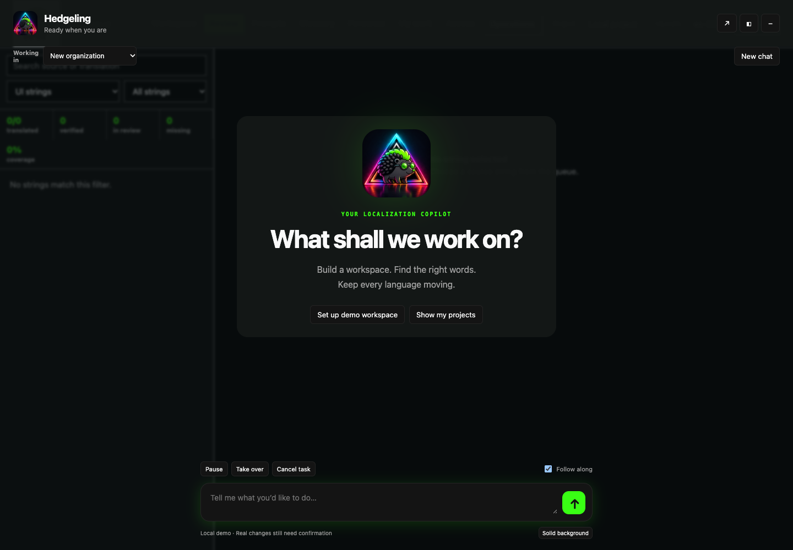
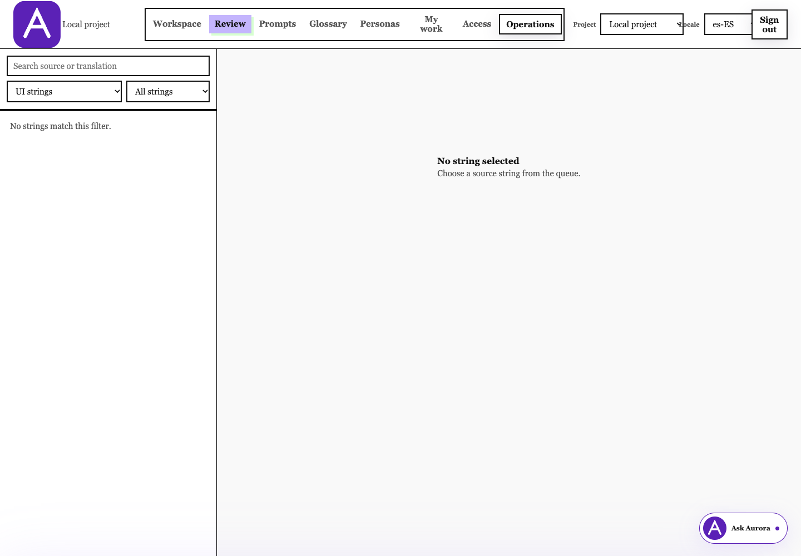

# Agent console implementation and local preview

The first milestone implements organization → business unit → project →
localization-job draft creation, workspace renaming, and job-draft editing.
Chat and manual forms use the same domain actions. Each change requires its
own preview and human confirmation.
The feature is disabled by default and has not been deployed.



## Try the workflow locally

Use Node 22 and a disposable local PostgreSQL database. Install the workspace
with `npm ci`, then run:

```sh
DATABASE_URL=postgresql://127.0.0.1:5432/hedgeling_agent_dev \
  npm -w @hedgeling/web-console run dev:agent
```

The command migrates the local database, creates the existing troubleshooting
fixtures and prints a local login URL and short-lived login token. Keep the
token private. It refuses remote databases and production mode. It does not
read repository environment files or retrieve cloud secrets.

After logging in, choose **Set up demo workspace**. Confirm the organization,
business unit, project and job separately. The demo uses deterministic model
responses but real API operations and database records; the UI labels it as a
local demo. The job initially has no source content. Existing import/repository
tools can populate the project's catalog before creating another job draft.

Use **Take over** to pause and inspect the resulting workspace. Manual forms
offer the same four creation actions. **Resume** reacquires control; it does
not automatically approve a pending change. A different tab must explicitly
take control. Presentation modes are independent of execution state.

In **Projects**, use the inline **Edit** controls to rename the organization,
business unit or project, or change a job draft's name, target languages and
workflow steps. A separate manual **Review & confirm** panel replaces the form
and shows **Current / After** values before saving. **Edit details** rejects the
old proposal and returns to the form with all entries preserved; **Cancel**
rejects it, resets the fields and closes the form. Returning to review generates
a new proposal. Older jobs remain visible immediately after saving, even when
outside the initial recent-job page.

The local demo supports `Rename project "Website" to "Marketing website"`
and the same quoted pattern for `organization`, `business unit`, and `job`.
It discovers matching records through MCP, follows pages, asks for a choice
when names are ambiguous, and waits for confirmation. Other job-setting edits
use the manual form locally; configured Gemini can use all four update tools.

## Console navigation

The console uses a collapsible sidebar and a compact header. The header contains
the workspace picker, **Ask Hedgeling** (`Cmd/Ctrl+K`), and the account menu.
The picker groups projects by organization and business unit; choosing an
organization while in Admin switches the administration context.

| Destination | Contents |
|---|---|
| Home | Accessible projects, organization counts, and actual work assignments |
| My work | Assignments and the project's Review queue; locale selection lives in Review |
| Projects | Business units, projects, localization-job drafts, and confirmed creation forms |
| Library | Glossary, personas, and prompts, shown according to project permissions |
| Admin | People/access, organization structure, identity/API, Billing & usage, AI providers & keys, agencies, usage/budgets, payments, and audit; Operations is separately permission-gated |

Appearance and sign-out live in the account menu. System/light/dark preferences
persist locally, and chat exposes the same theme control. Mobile uses a keyboard
accessible navigation drawer. URL fragments preserve sections across refreshes
and browser back/forward navigation. Manual navigation disables **Follow along**;
the agent continues only within its existing execution/confirmation rules.

Manual browsing remains available with the assistant disabled. Organization and
project changes still use server authorization; hiding navigation is not an
authorization boundary. Opening the chat panel temporarily compacts the sidebar
without changing the user's saved collapsed/expanded preference.

Run `npm -w @hedgeling/web-console run test:navigation:browser -- <local-db-url>`
for isolated browser checks of navigation, permissions, themes, history,
responsive layout, and manual browsing without the agent.

## Billing and included chat

Chat is included with active platform access and the 14-day trial; it does not
consume translation credits. Expired trials show **View plans** for billing
managers and an owner/admin handoff for other roles. Histories remain readable.
Server-side checks apply to old runs as well as new chats. Usage guards still
bound chat costs; reaching a fair-use limit never starts paid chat overages.

**Admin → Billing & usage** shows the plan, string capacity, translation
credits, AI-overage estimate and reviewed spending limit. Hosted Stripe pages
handle cards and invoices. Checkout stays explicitly unavailable when its
server configuration is missing; local troubleshooting accepts test keys only.

**Admin → AI providers & keys** supports a Gemini key on every paid plan,
masked metadata, access testing, replacement/removal, and explicit translation
provider selection. Settings use their own native confirmation panels. Keys are
encrypted even in pending previews. Editing a key preview requires re-entering
the key. Chat remains on the managed provider. Removing a selected BYOK key
blocks new AI translation until a key is connected or the owner explicitly
switches to managed AI; it never causes automatic managed-credit spending.

The local deterministic demo remains available without fabricated commercial
records. A real trial record in that database still expires normally. Production
chat requires a selected organization with current commercial access; creating
an empty organization does not silently grant another trial.

See [billing configuration and key-storage contract](BILLING-ENTITLEMENTS.md#included-chat-and-organization-ai-keys).
Run `test:commercial:browser` against disposable loopback PostgreSQL for the
desktop/mobile billing, key confirmation and expired-trial flow. The full
authorization suite also verifies BYOK revisions and zero managed-credit charges.

## Typewriter chat and attention cues

Chat uses a paper transcript and a compact paper composer with one raised
“Send ↵” key as a typewriter detail. Enter sends and Shift+Enter inserts a
newline. Light and dark paper, ink, highlighter, and key colors come from the
active brand's tokens.
Paper text, secondary text, stamps, keys and control outlines use stronger
contrast in both themes; `agent-control-line` separates interactive boundaries
from the quieter paper ruling. The compact layout is unchanged.
Courier Prime is self-hosted with its SIL Open Font License in each brand's
assets folder ([upstream source](https://github.com/google/fonts/tree/main/ofl/courierprime)).
New assistant messages receive a short visual ink reveal after the complete
response arrives. This is presentation, not incremental model streaming.
Reduced-motion preferences disable the reveal and highlight pulse.

With **Follow along** enabled, trusted tool names identify the workspace section
being read or prepared. Pending proposals mark the related creation control and
approval card; successful confirmations mark the actual resource returned by the
API. Labels and outline styles distinguish working, awaiting approval, and
created states. Model text is never interpreted as a selector or click command.
These cues do not press controls, grant approval, or bypass permissions.

Pause, takeover, manual navigation, errors, and turning Follow along off clear
attention cues. Historical events do not replay navigation or highlights. A
completed/read highlight expires; a pending approval stays marked until the next
activity or a user control clears it. The first version covers workspace tools;
future tools need explicit semantic destinations in the console.

In the local demo, **Try card examples** opens `/agent-preview.html`:

- Approval uses the live shared card component with example-only callbacks.
- Options use native radio cards; free-form examples use labeled, validated fields.
- All playground submissions stay in browser memory; no action or agent request
  is sent and no workspace resource is changed.

Chat approvals use the paper card, conversational guidance and Confirm/Discard.
Manual confirmations use the console's regular typography and a dedicated review
step with Save/Create, Edit details and Cancel; they do not ask the user to reply
to the agent. Both render the same immutable server preview and use the same
confirmation rules. Changing those details requires a new proposal and
fingerprint. Structured options and
free-form cards are design examples for now; the live agent asks follow-up
questions through ordinary chat. An answer never doubles as write approval.

## Enable Gemini

Use server-side configuration only:

| Setting | Meaning |
|---|---|
| `HEDGELING_AGENT_ENABLED=true` | Enable the assistant and workspace action API |
| `HEDGELING_AGENT_ORG_CREATION_ENABLED=true` | Allow named users to propose an empty customer organization |
| `HEDGELING_AGENT_PROVIDER=gemini` | Use Gemini; `fixture` is allowed only with local authentication outside production |
| `HEDGELING_AGENT_GEMINI_MODEL` | Explicit model ID; existing `HEDGELING_GEMINI_MODEL` is an alternative |
| `HEDGELING_GEMINI_API_KEY` | Server-side managed key; existing `GEMINI_API_KEY` or `GOOGLE_AI_API_KEY` is also recognized |

Set the provider to `gemini` when using `dev:agent` with a configured managed
key. Missing model/key configuration disables chat with an explanation while
the manual workspace remains available. There are no browser model credentials
or deployment-specific endpoint defaults.

The adapter uses Google's
[GenerateContent API](https://ai.google.dev/api/generate-content), structured
function calls, and complete private model-history parts. It sends only public
assistant text and tool activity to the browser. Text appears after a model
response completes; incremental token streaming is not implemented yet.

## Components and contracts

| Component | Responsibility |
|---|---|
| `packages/api-contract` | Fifteen shared actions and strict Ajv input schemas |
| `web-console/src/reporting.js` | Versioned organization-wide reporting packages and aggregate queries |
| `web-console/src/workspace-read.js` / `pagination.js` | Authorized paged reads and signed continuations |
| `web-console/src/workspace-actions.js` | Scope checks, canonical previews, revalidation, idempotent confirmation, audit and resource writes |
| `web-console/src/workspace-management.js` | Permission-scoped edit previews, before/after values, row locking and version-checked updates |
| `web-console/src/agent-runtime.js` | Persistent conversations/events, control leases, serial tool loop, pause/cancel and SSE replay |
| `web-console/src/agent-mcp.js` | Real MCP SDK client/server over an in-process transport using trusted delegated identity |
| `web-console/src/agent-provider.js` | Gemini transport, cancellation, bounds and usage reservations; separate local demo provider |
| `web-console/src/agent-skills.js` | Versioned setup, management, reporting, pagination and handoff guidance |
| `web-console/src/public/agent*` | Shared chat shell, confirmation cards and manual workspace |
| `web-console/src/public/console-shell*` | Sidebar, workspace picker, Home/Library, Admin sections, account menu, and responsive navigation |
| `packages/design-system` | Brand manifests, semantic tokens, generated CSS/JSON/module assets and compatibility tokens |

The action catalog is `GET /api/actions`; calls use
`POST /api/actions/:name`. Workspace reads are `organizations.list`,
`workspace.get` and `localization_jobs.list`. Creation actions are
`organization.create`, `business_unit.create`, `project.create` and
`localization_job.create`. The original `projects.list` and
`project.sync.status` remain available. Organization-wide reports are
`reports.workspace.summary` and `reports.jobs.summary`.
Update actions are `organization.update`, `business_unit.update`,
`project.update` and `localization_job.update`; their MCP names are
`console_propose_organization_update`, `console_propose_business_unit_update`,
`console_propose_project_update` and `console_propose_localization_job_update`.

Lists are now paged (50 by default, at most 100 per page), with explicit
continuation and authorized totals. See [Reporting and pagination](REPORTING-AND-PAGINATION.md)
for query packages, coverage, client migration, the full caps table, and growth plans.

Creation and update calls return a proposal with ID, normalized fields,
parent/resource versions, side effects, fingerprint and expiry. Updates also
include before/after values. The proposal alone does not change the resource.
`POST /api/agent/proposals/:id/confirm` requires the signed-in person's console
cookie, controller ID and matching fingerprint. Bearer callers and delegated
agent principals cannot confirm. This is deliberately absent from MCP tools.
The confirmation transaction rechecks permissions and resource versions, then
records the resource, audit event, result and conversation checkpoint together.

Chat uses delegated organization/project permissions from discovery through
execution. Platform-admin access alone remains a manual-console capability;
it does not grant chat access to every customer organization. `/api/agent/config`
keeps the manual workspace inventory and adds `agentAccess` to each organization
so the chat can explain a missing role separately from a plan or provider issue.
Conversation creation and replay check the same delegated scope as tool execution.
If an administrator can browse an organization but cannot chat there, review the
person's active membership and scoped role under **Admin → People & access**, then
start a new chat. Use the appropriate role for their work; ownership is not required.

Renames preserve IDs and slugs. Organization and BU edits require the existing
`organization.update` and `business_units.manage` permissions; project renames
require unscoped `projects.manage` for that project. Job edits require
`jobs.view` and the new `jobs.update` permission for **every current and proposed
target locale**. The migration grants `jobs.update` to built-in organization
owners, platform super admins and localization managers; custom roles require
an explicit grant. A creator/requester role alone does not permit job editing.
Confirmed updates lock their target rows, revalidate the preview's row versions,
and audit the previous changed fields. Conflicting previews require a new read
and confirmation; duplicate confirmation returns the saved result.

Job edits retain their original source snapshot and source language. Omitted
fields stay unchanged; target-language and step arrays replace their selection.
Only drafts can be edited. Archiving, deletion, moving resources, changing
project languages, and job execution are outside these update actions.

An organization starts empty with its owner membership and identity policy.
It creates no subscription, billing account, API credential, BU or project.
Job drafts snapshot the current source catalog and selected locales/steps;
they are distinct from vendor work orders and processing records. Draft jobs
cannot execute translations or publish content in this milestone.

The stdio adapter shares the action definitions. Its existing service-account
reads remain supported; creation and update proposals currently require a named human
principal. Remote MCP OAuth and console confirmation of externally delegated
write proposals remain phase 5.

## Control and authorization

Conversations belong to one user and one organization, or to new-organization
setup. Tools cannot silently cross that scope. Organization creation binds the
conversation to the resulting organization. The model receives a delegated
user context without platform bypass privileges and with human-only decisions
disabled. Every action still passes domain authorization.

Permission snapshots include membership/team changes, scoped grants and their
expiry, identity/recovery/support rules and data lifecycle state. Changed access
blocks further conversation reads, tool dispatch and confirmation. Starting a
new conversation loads the new permissions instead of replaying privileged
history. Jobs are visible only when their target-locale scope is permitted.

The browser renews a 30-second controller lease every 8 seconds. Pause/cancel
lock the same run row used by confirmation, advance its generation and stop
new dispatch. Already committed changes remain visible. Disconnecting the
controlling event stream pauses its run; an observing tab does not. Restarted
processes do not automatically restart model work. Reload restores durable
events and requires control to be reacquired when necessary.

The transparent overlay makes the underlying interface inert and traps focus.
The side panel leaves it available. Following uses a fixed workspace target,
refreshes real resources and stops for unsaved edits. Broader page/record
navigation is a later extension. The launcher is mounted on console,
onboarding and operator pages; sign-in pages do not expose chat.

## Limits and operational boundaries

- Sixteen model steps and at most eight tool calls per step; calls are serial
  and the first write proposal stops further business changes.
- A 90-second provider timeout, 4,096 output-token setting, and 750,000-byte
  serialized request guard (including tools and opaque replay state; not a native
  context-token limit). Usage reserves those bytes plus output headroom and
  reconciles provider usage. Provider responses remain bounded to 512 KiB.
- User messages allow 24,000 characters. Conversation replay follows 250-event
  pages before reconnecting live updates, preserving old approvals as history.
- A 500,000-token daily user allowance, a 2,000,000-token organization allowance
  through existing usage accounting, and existing organization budget checks.
  Server-granted demo allowances are 10 million daily user tokens and 50 million
  tokens per organization usage period; plan defaults are unchanged.
  Unknown dispatched outcomes retain a conservative reservation charge.
- Up to 100 conversations and 200 proposals per user per rolling day, five
  organization creations per day, a 1,000-entry model-history admission cap,
  and 15-minute proposal expiry.
- Drafts snapshot at most 10,000 source strings and 30 target locales.
  Creation enforces initial organization bounds of 100 BUs/250 projects;
  existing trial accounts retain one BU, one project and three locales.

Migration `202610241200_agent_console.sql` adds conversations, events,
proposals, model usage and localization-job drafts. It is additive and mirrored
in the bootstrap schema. Project content purging removes its job snapshots and
conservatively removes that organization's agent conversations/proposals.
There is no automatic transcript-retention scheduler or user export/delete UI
yet. Approve retention/provider-content policy before enabling a customer pilot.

## Replace the brand

```sh
npm -w @hedgeling/design-system run build -- aurora
# Restore the default brand:
npm -w @hedgeling/design-system run build -- hedgeling
```

Edit or replace `brands/<name>/tokens.json`, `brand.json` and `assets/`, then
rebuild the consuming applications. Generated root files and legacy console
tokens must be committed together. Both brands use the same semantic keys.
Brand swapping covers tokens, typography, logo, mascot and displayed product
identity; it does not rewrite marketing prose or change navigation/permissions.
The default preview mascot is an unchanged reference copy, pending production
asset optimization.



## Verification and next milestone

Run console unit/lint checks, MCP build/tests, design-system tests and the
marketing production build. With `TEST_DATABASE_URL` pointing to a disposable
local database, run console `test:authorization`, `test:local`, `test:agent`
and `test:agent:browser`. Install Playwright Chromium first, or use
`HEDGELING_E2E_CHROMIUM_EXECUTABLE` to select an installed test browser.

The agent integration tests cover both chat and manual creation, duplicate and
tampered confirmations, pause, bearer denial, stale source/parent versions,
expired proposals/grants, revoked access and organization isolation. Browser
checks cover real resources, presentation modes, takeover/resume, keyboard
focus, mobile layout, replay, a second brand and the onboarding launcher.
Provider tests mock HTTP; a live Gemini smoke test and role/task evaluations
remain required before rollout. No paid model calls are part of these tests.
The console production audit is clean with MCP SDK 1.32.2, Zod 4.6.7 and
fast-uri 3.1.9. The Docker dependency copy preserves workspace-local packages;
the production image itself still needs a container build and startup check.

Next, implement a separately previewed `localization_job.start`: bind it to the
source snapshot, target locales, workflow steps and cost ceiling. One confirmed
start authorizes saving generated drafts within those bounds. Persist worker
checkpoints and actual usage, stop on cancellation or an exhausted ceiling,
and leave final review/publication to separately confirmed human decisions.
Then extend translation/review, asset management, reporting packages and remote
MCP according to the approved specification. Organization-owned translation
keys and the first account-wide reporting packages are included in this foundation.
