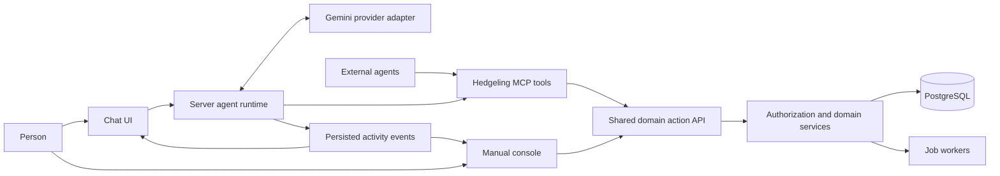
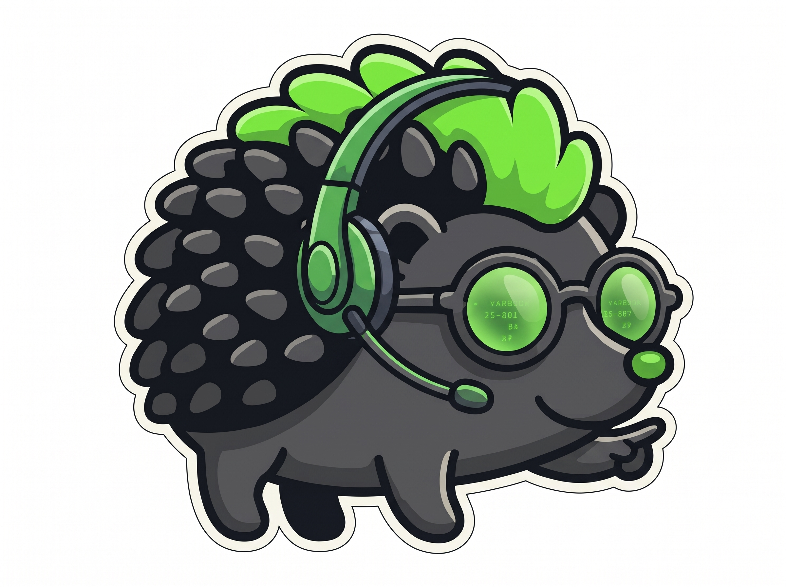

# Hedgeling agent console specification

> Inherited product document. See [the hackathon plan](../HACKATHON-PLAN.md) for the current Meta/provider roadmap and [the boundary](../REPOSITORY-BOUNDARY.md) for excluded private components.

Status: approved product and architecture direction, 2026-10-24. The first
implementation covers workspace creation through localization-job drafts;
see [implementation and local preview](AGENT-CONSOLE-IMPLEMENTATION.md) for its
verified behavior, configuration and remaining release gates. Later phases
below remain the delivery plan, not a claim of deployed functionality.

Hedgeling's primary console interaction will be a natural-language conversation.
Users can watch the agent work in the actual console, inspect each proposed
change, and take over at any time. The ordinary interface remains a complete
way to work. Both the built-in assistant and external agents use the same
domain actions, permissions, and results.

## Confirmed product decisions

| Area | Requirement |
|---|---|
| Primary interaction | Natural-language chat, with the underlying console visible and usable through a deliberate handoff |
| Presentation | Persistent launcher, transparent full-screen overlay, ordinary side panel, and minimized state |
| Audience | Owners, project managers, developers, translators, reviewers, and other linguists, within their actual permissions |
| Control | Pause the agent, take over manually, and resume with updated context; provide handoff when a tool is unavailable |
| Changes | Preview every proposed business-data change and require a separate confirmation for each write |
| Bounded job execution | A separate job-start confirmation authorizes generated draft translations for the previewed source snapshot, target locales, workflow steps and cost ceiling. Final review, publication, access changes and spending changes still require separate confirmations. |
| First complete workflow | Create an organization, business unit, project, and localization job |
| Job meaning | Source content, target locales, and workflow steps such as translation and review |
| Model provider | Managed Gemini for included chat; managed credits or an organization Gemini key for translation |
| Chat access | Included in platform plans and the 14-day trial, with fair-use limits. Trial expiry prompts upgrade; chat never consumes translation credits. |
| Branding | Replace one design-system package or folder to change brand styling and visual assets across the site |
| Agent guidance | Versioned skills for clarification, workflow sequencing, and tool selection |
| External access | MCP for external agents, backed by the same API as the console |

## Existing foundation and gaps

This specification records the original pre-existing product design. The public
hackathon baseline and current provider direction are recorded in
[the repository boundary](../REPOSITORY-BOUNDARY.md) and
[the hackathon plan](../HACKATHON-PLAN.md). The table below is historical;
the implementation guide records the features subsequently delivered.

This table records the planning baseline. The implementation guide tracks
what has since changed.

| Area | Existing code | Work still needed |
|---|---|---|
| Shared API and MCP | `packages/api-contract` defines `projects.list` and `project.sync.status`; API actions and stdio MCP consume the contract | Output schemas, richer input validation, write proposals, approvals, jobs, additional tools, remote MCP |
| Identity | Named human sessions, scoped service accounts, local troubleshooting mode, human-only decision checks | Trusted delegated agent identity and per-write approval execution |
| Organization setup | `self-service.js` creates an initial organization, default BU, project, and credential together | Staged creation compatible with separate confirmations; existing-organization project creation |
| Business units | `access-admin.js` has permission-checked creation and management | Shared action contract and MCP coverage |
| Linguistic work | Review queue, AI revisions, language assets, assignments, vendor work orders | Chat presentation and localization-job orchestration |
| Gemini | `server.js` contains a server-side text-generation/revision helper, with usage and budget code nearby | Conversational tool loop, streaming, checkpoints, cancellation, provider adapter |
| Design system | `packages/design-system/theme.css` is shared by marketing and several console surfaces | Main console CSS still duplicates tokens; JSON tokens and CSS have drifted; no complete interchangeable brand package |

The older console UX brief (private product document; not included in this export) remains useful for
capability and navigation inventories. This specification takes precedence for
the new chat interaction and control model. The
[foundation guide](AGENT-FOUNDATION.md) remains authoritative for authentication
and local troubleshooting; the implementation guide extends its action catalog.

## Chat and visible agent work

### Shell and presentation modes

The authenticated shell retains organization and project context, breadcrumbs,
navigation, profile, and a persistent Hedgeling launcher. First use opens a
chat-forward workspace with suggested tasks appropriate to available
capabilities. Remember the user's later presentation choice instead of reopening
the full-screen overlay on every navigation.

| Mode | Behavior |
|---|---|
| Full-screen overlay | A transparent canvas over the current page, readable message and action cards, and a view of the agent's current target. Use local opaque surfaces behind text, configurable scrim/blur, and an opaque fallback. |
| Side panel | Resizable conversation panel beside the working page. The same conversation, pending proposal, and run continue across mode changes. |
| Minimized | A compact persistent icon with textual/accessible state: working, waiting for confirmation, paused, failed, or complete. Selecting it restores the previous mode. |
| Manual control | The user owns navigation and editing. The assistant remains available; automated mutation dispatch and forced navigation are paused. |

Presentation state is independent of execution state. Minimizing does not
approve a change, cancel a run, or resume a paused run. On small screens, use a
full-screen chat or explicit switch to the working page instead of an unusably
narrow panel. Keep the launcher clear of save buttons and editing controls.

### Conversation components

- A composer with explicit organization/project/locale context and suggested
  tasks; selected records may be attached as structured context.
- Short progress updates grounded in actual work, followed by result cards
  linking to the affected resources. Show readable activity, not private model
  reasoning or fabricated progress.
- Clarification cards with useful choices and a free-text answer. Ask for
  missing information that changes the result; reuse facts already supplied.
- Write previews with resource, scope, before/after values or creation fields,
  affected counts, expected cost where relevant, and one confirmation button.
- Clear Pause, Take over, Resume, and Cancel controls. Explain any step that
  has already completed or cannot be interrupted.
- Recoverable errors with a useful next action and an optional support
  reference; no raw provider responses or internal stack traces.

### How users watch the agent

Execute domain operations through the API. Mirror their real progress in the
console using structured events: open the project page, select the locale,
focus the relevant record, show a draft in a form, highlight a proposed action,
and refresh data after a confirmed write. A visible pointer or highlight is
optional presentation. Never manufacture a click or completion that did not
happen.

Use an allowlisted route and component registry keyed by resource IDs. The
model cannot provide arbitrary scripts, selectors, or destination URLs.
Navigation can happen before execution; success styling only follows a durable
operation result. Let users turn off automatic page following without stopping
read-only work. Unsaved edits always interrupt agent-driven navigation.

If a tool is unavailable, open the relevant manual screen, preserve the plan,
explain the next step, and wait. On resume, read actual server state rather than
assuming the user completed the action. Browser automation is a separate future
capability, not an implicit fallback for missing MCP tools.

### Pause and takeover contract

Proposed run states are `planning`, `reading`, `awaiting_input`,
`awaiting_confirmation`, `executing`, `pausing`, `paused`, `completed`,
`failed`, and `cancelled`.

Pause fences new dispatch immediately on the server. Cancel cancellable model
requests and pending work. A database transaction or provider task already
committed may finish; show it as in flight until the outcome is reconciled.
Only acknowledge `paused` after no further dispatch can occur and outstanding
effects are known. Cancellation prevents future steps; it is not rollback.

Take over requests pause and grants manual control after that barrier. Use a
run generation/dispatch fence and a single controlling browser-tab lease so
stale workers or tabs cannot keep executing or navigating. Prefer serial writes
in the first version. A disconnect pauses foreground dispatch; separately
confirmed background jobs may continue and remain visible in the job center.
An already submitted job has a known submission outcome even while its workers
continue. Pausing the agent does not wait for that whole job to finish or claim
to pause its workers; pausing/cancelling a job is a separate domain action with
its own preview and confirmation.

Resume rereads affected resources and permissions, compares versions, and
invalidates stale proposals. Never overwrite a human edit with a pre-pause
plan. Undo, when supported by a domain operation, is another previewed and
confirmed write; it is not guaranteed for every action.

## Confirmation and permissions

Every business-data write proposed by an agent requires its own confirmation.
There is no initial blanket approval of an entire multi-step plan. Read-only
queries, chat persistence, proposal storage, audit records, and run checkpoints
do not require separate confirmations. Saving an AI draft into a project does;
showing a suggestion only in the conversation does not.

A preview names all unavoidable side effects. Organization creation can include
its required initial owner membership, but must not silently create an extra
project, API credential, or paid subscription. Creating a job draft and starting
its work are separate actions. A typed conversational acknowledgment is not
sufficient to bypass the dedicated confirmation control in the first release.

The server binds a confirmation to an immutable proposal ID, canonical inputs,
operation version, resource versions, scope, expiry, and idempotency key. Before
committing, it checks the approver's current rights and the proposal again.
Changed inputs, changed content, changed cost bounds, or stale versions require
a new preview. Retries with the same key reconcile one effect; they do not
create duplicates. A second attempt with different inputs is a new action.

Agent approval to perform an ordinary write and a human-only business decision
are distinct. Existing translation, asset, quality, financial, ownership, and
access decisions retain their human requirements. The agent may prepare the
proposal, but the authenticated person performs that decision through a trusted
console control. The agent does not receive a reusable human credential or an
approval tool that lets it impersonate the person.

For ordinary delegated actions, authority is the intersection of current user
permissions, approved scope, agent capabilities, and organizational policy.
For machine-only external runs, use the service account's own scope; an
unattended service account cannot supply a human confirmation. External write
tools should create proposals and return an authenticated console review link,
then allow status polling. Use an approved internal credential exchange for
MCP-to-API calls, with separate audience-bound credentials.

| User type | Example experience | Boundary |
|---|---|---|
| Owner/admin | Set up an organization, BU, project, and job; inspect budgets | Ownership, access, and money decisions remain deliberate human actions |
| Project manager | Prepare localization jobs, choose workflow and assignees, monitor progress | Project scope, assignment eligibility, entitlements, and budgets |
| Developer | Inspect sync, source content, imports and integration status | Project/tool credentials; no implied billing or personnel authority |
| Internal translator | Find assigned content and prepare translation changes | Allowed projects, locales, and edit permissions |
| Reviewer or specialist | Inspect evidence and prepare review or asset decisions | Specific review capabilities; final human-only decisions stay human |
| Agency linguist | Work within assignments and their exact content | No general customer-project access from agency membership alone |

The UI composes effective capabilities instead of forcing a single role choice.
An organization switch starts a new scoped conversation or explicitly changes
scope; previous tenant content must not enter the next model request. Recheck
access when replaying conversation content or events, not just when created.

## First complete workflow

Example intent: “Set up Acme, create a Product business unit and Website project,
then prepare a French and German localization job with translation and review.”

1. Resolve whether the user is creating a new organization or working in an
   existing one. Ask for only the missing organization type/name, source locale,
   target locales, content source, and workflow details.
2. Preview organization creation, including the initial owner and any trial
   terms. The authenticated user confirms this bootstrap action.
3. Preview and confirm BU creation within that organization.
4. Preview and confirm project creation, including source/target locales and
   its BU. Use the actual IDs returned by the previous steps.
5. Resolve existing source content or hand off to a supported import/connection
   flow. Missing source content can produce a clearly incomplete draft, not a
   job presented as ready to run. Imports and connection changes have their own
   previews and confirmation.
6. Preview and confirm the localization-job draft with content snapshot/counts,
   locales, steps, assignment strategy, due date if supplied, and cost estimate
   or an explicit unavailable estimate.
7. Show the resulting hierarchy and job page. Starting work is a separate
   preview and confirmation, with eligibility and spending checks. Creating
   the draft never silently starts paid generation or vendor work.

Each step can be paused, retried, or handed to the user. If a later step fails,
show the resources already created and resume from there. Do not delete earlier
resources automatically. Existing onboarding bundles several of these changes;
refactor its services rather than wrapping the bundled endpoint and pretending
the confirmations are separate.

### Localization job model

A localization job is a business work container scoped to one project. Proposed
fields include `id`, organization/BU/project IDs resolved by the server, name,
source-content snapshot and versions, source locale, target locales, workflow
steps, assignment constraints, due date, status, and audit references.

Use draft, ready, running, blocked, completed, and cancelled as initial business
states, with step-level progress and explicit reasons for blocked work. The
ready transition checks content, locales, permissions, assignees when needed,
and required configuration. Do not reuse this lifecycle for agent runs.

A job may contain machine translation, human translation, review, and QA steps.
Vendor work orders can fulfill steps while retaining their own commercial
states. Background processing tasks execute steps. Agent runs organize the
conversation and tool calls. Keep these four concepts distinct in code and UI.

Confirming a bounded job start authorizes only the previewed execution scope,
including the displayed content versions, steps, outputs, and spending ceiling.
Whether job workers may persist all those outputs under that single domain
operation, or each generated content change needs another confirmation, is an
open product decision before automated execution ships. The first workflow
ends at job creation and does not assume that exception to per-write approval.

## Runtime and MCP architecture



The model proposes tool calls; the runtime validates and schedules them. MCP
adapts domain operations. The API owns validation, permissions, approvals,
idempotency, transaction boundaries, and audit. Manual UI actions call that API
directly. See [API and MCP design](API-AND-MCP-DESIGN.md) for the GraphQL decision
and proposed operation catalog.

Start with one server runtime and a bounded tool loop, not multiple autonomous
agent workers. Persist conversations, runs, proposals/confirmations, tool
invocations, and ordered activity events. Proposed event fields include run ID,
sequence, scope, step ID, operation ID, status, resource references, safe UI
target, and timestamp. Save business changes and their domain events atomically
with an outbox or equivalent; reconcile provider side effects explicitly.

Use a resumable event stream, initially SSE with authenticated same-origin
access and a sequence cursor. UI rendering consumes events and fetches current
authorized resources. It never replays business mutations when reconnecting.
Keep narrative progress, audit history, and domain-job status separate. The
browser does not need to remain connected for a previously confirmed job to
finish.

The API must stamp agent execution identity from trusted server context; a
client-supplied flag cannot turn an agent into a human or broaden its rights.
Reuse the existing local troubleshooting mode and add an offline fake provider
and disposable fixtures for the chat flow. Local mode does not bypass the new
approval rules or require a live Gemini key for debugging.

## Gemini integration

Use the existing server-side key configuration for the first release. The new
provider adapter supports streamed text, structured tool calls/results,
cancellation, usage accounting, and bounded retries. Google's
[function-calling interface](https://ai.google.dev/gemini-api/docs/function-calling)
supports model-selected functions and structured arguments; execution and
approval policy remain Hedgeling's responsibility.

Extract reusable configuration and accounting from the current revision helper;
it is a single text-generation call, not an agent runtime. Keep model IDs and
provider selection configurable, pin a tested model/API/SDK combination for
release, and preserve provider-required conversation state inside the adapter.
Do not expose raw provider metadata or internal reasoning in activity events.

Set explicit per-turn/run limits for time, tool calls, tokens, and cost, with
organization budget enforcement. Failed, cancelled, and retried calls still
need accurate usage accounting. Redact credentials from errors and telemetry;
send only authorized, relevant project content. Missing configuration disables
AI clearly while manual console workflows continue to function.

Organization-owned translation keys use encrypted storage, replacement/removal,
permission checks, explicit routing, usage attribution, and deletion behavior
as implemented in [Billing & entitlements](BILLING-ENTITLEMENTS.md#included-chat-and-organization-ai-keys). Never send keys to
the browser, MCP tool arguments, transcripts, or public frontend configuration.
Keep the provider boundary replaceable; changing providers should not change
domain actions, the control model, or the chat UI.

## Skills and tool selection

Keep product-agent skills in a versioned server-owned package, proposed as
`packages/agent-skills`. These are Hedgeling application capabilities, distinct
from a developer's local coding-agent skills.

Each skill contains an ID/version, description and trigger, required context,
clarification rules, allowed action names, workflow steps, handoff conditions,
completion evidence, and evaluation cases. Load a relevant subset based on
intent and effective capabilities. Skills do not grant permissions or override
confirmation rules. Tool allowlists are enforced in code.

| Initial skill | Guidance |
|---|---|
| Workspace setup | Resolve new versus existing organization, create the hierarchy one confirmed step at a time, avoid duplicate creation |
| Localization job preparation | Resolve content and locales, explain workflow choices, prepare a draft, separate creation from execution |
| Translation review | Load source/context, propose edits, preserve locale scope, hand final approval to the human |
| Language assets | Identify the correct prompt/glossary/persona version, preview a change and its scope |
| Project status | Use read tools, cite actual jobs/sync results, explain missing data without inventing progress |
| Manual handoff | Explain the missing capability, open a supported screen, pause, and verify state after resume |

Prefer the smallest suitable domain action, inspect state before proposing a
mutation, and use structured questions when scope is ambiguous. Do not give
the model unrestricted SQL, a general HTTP fetch tool, or a generic “execute any
operation” tool. External content, translations, attachments, tool output, and
customer-authored prompts are data and cannot replace system policy.

Start with reviewed built-in skills. Later organization-specific guidance can
add terminology and workflow preferences beneath system rules, with versioning
and evaluation before activation. MCP prompts/resources may expose compatible
guidance to external clients, but those clients are not guaranteed to follow
it; enforcement stays in the API.

## Interchangeable design system

Use the supplied headset mascot as the approachable assistant reference and
the neon artwork as an optional ambient direction. Translate the images into
lime accents, charcoal surfaces, selective cyan/magenta glow, and clear agent
states. Reserve strong glow and motion for the launcher and focused activity;
dense translation tables need quiet, legible surfaces in both light and dark.

| Headset mascot | Neon direction |
|---|---|
|  |  |

These are user-supplied visual references, not embedded instructions. The local
preview uses an unchanged copy of the neon reference through the brand manifest.
Prepare optimized production assets separately and preserve these originals.

Proposed package shape:

```text
packages/design-system/
  schema/                  # Semantic token and brand-manifest contract
  components/              # Shared accessible component recipes
  brands/hedgeling/
    tokens.json            # Canonical colors, typography, spacing, shape, motion
    brand.json             # Product/agent names, assets, icon and illustration slots
    assets/                # Logos, mascot states, fonts, backgrounds
  generated/theme.css      # Generated output, never hand-maintained
```

Use semantic tokens such as `surface.canvas`, `surface.chat`, `text.primary`,
`status.pending`, `agent.highlight`, and `motion.activity`; avoid business
components hardcoding brand colors or mascot filenames. Keep brand presentation
separate from agent behavior, permissions, and organization configuration.

The first migration reconciles CSS/JSON drift, removes duplicated global values
from `src/public/styles.css`, and adopts shared typography, spacing, radii,
states, and component recipes. Cover marketing, login/onboarding, console,
operator screens, agent UI, and errors. Generate compatibility aliases while
older screens migrate. Initial swapping can be a build-time brand selection;
per-organization white labeling is a separate later feature.

Completion test: render a deliberately different second brand from a replacement
brand folder without changing application components. This promises visual and
asset replacement; arbitrary navigation or product behavior changes still need
application work.

Design acceptance includes keyboard-only operation, readable contrast over any
background, screen-reader status updates, focus restoration, reduced motion,
reduced transparency/opaque fallback, and non-color status indicators. In the
full-screen overlay, explicitly control whether the background is inert; do not
allow accidental click-through writes. In the side panel, offer clear keyboard
movement between conversation and workspace.

## Delivery plan and acceptance gates

| Phase | Deliverable | Exit evidence |
|---|---|---|
| 0 | Reconcile foundation PRs and resolve remaining product decisions | Current auth/local mode passes; operation and job terminology agreed |
| 1 | Shared brand package, app shell, and three chat modes using deterministic demo events | Light/dark and second-brand previews; keyboard/reduced-motion/opaque modes; no simulated events presented as live work |
| 2 | Runtime, delegated identity, proposal/confirmation contract, event persistence, pause barrier | Two existing read tools work through Gemini; rejected/stale proposals cannot commit; reconnect and takeover tests pass |
| 3 | Organization, BU, project, and localization-job draft workflow | Each write separately previewed/confirmed; repeat/retry produces one resource; partial failures resume; manual equivalents work |
| 4 | Job execution, translation/review, developer sync, language assets, reporting | All-role task evaluations, human-decision enforcement, budget/cancellation behavior, bounded background-job approval policy resolved |
| 5 | Remote MCP and external-client parity | OAuth and audience isolation, same scoped results, external proposals confirmed in console, compatible stdio retained |
| 6 | Organization-owned model keys, configurable skills, richer mascot/motion | Key lifecycle, skill evaluations and brand replacement verified |

External clients can use existing stdio capabilities before phase 5. Remote
hosting is a deployment and identity milestone, not a second implementation of
business tools. Complete each workflow vertically; avoid rewriting all console
pages before the first useful task works.

Required behavioral evaluations include missing information, duplicate names,
unsupported tools, insufficient permissions, multi-role users, agency/locale
restrictions, cross-tenant context, revoked rights, stale previews, duplicate
confirmations, pause during an in-flight write, disconnect/reconnect, manual
edits before resume, model timeout, and exhaustion of budget/tool limits.

Track task completion, confirmation rejection/edit rate, tool-selection errors,
manual handoffs, recovery success, latency, and per-task model cost. Never count
a confident chat answer as success without the expected resource state. Record
model and skill versions for reproducible evaluations. Transcript retention and
redacted diagnostic access must be set before pilot rollout.

## Remaining decisions

- The API/MCP direction is approved; GraphQL federation remains deferred.
- Bounded job-start approval is resolved: generated draft writes are covered
  only within the exact previewed content, locales, steps and cost ceiling.
  Changing those bounds requires a fresh preview and confirmation. Stop at
  human review; approval and publication are separate decisions.
- The draft implementation snapshots the existing source catalog. Existing
  import and repository tooling provide source content through manual handoff;
  upload and agent-driven import remain later capabilities.
- Set conversation retention, deletion/export behavior, and any organization
  policy for sending project content to the model provider.
- Decide whether to expand later into voice, proactive notifications, shared
  conversations, unattended automation, or per-organization branding. None is
  required for the first workspace-creation workflow.
