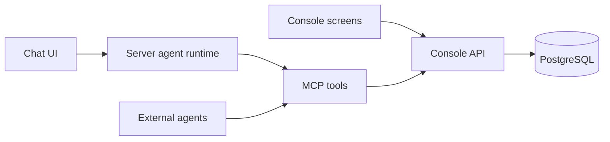

# Console and agent foundation

The console API owns authentication, project scope, permissions, validation and
audit. MCP adapts named API actions for agents. The chat UI calls a server-side
runtime that uses MCP tools backed by those same domain actions.
Ordinary console screens can call the API directly.

The approved chat experience, per-write confirmations, takeover behavior,
localization jobs, and delivery phases are specified in the
[agent console specification](AGENT-CONSOLE-SPEC.md). The
[API and MCP design](API-AND-MCP-DESIGN.md) explains the domain action approach
and when GraphQL might be introduced. The
[first implementation guide](AGENT-CONSOLE-IMPLEMENTATION.md) covers chat,
creation proposals, localization-job drafts and current rollout limits. The
contract below describes the original foundation reads.



## Implemented contract

`packages/api-contract` defines action names, input schemas, permissions and
read-only classifications. The API and MCP server consume this same package.

| API action | MCP tool | Authorization |
|---|---|---|
| `projects.list` | `console_list_projects` | Only projects visible to the authenticated principal |
| `project.sync.status` | `console_get_sync_status` | `strings.view` on the explicit `projectSlug` |

`GET /api/actions` returns the authenticated action catalog. Invoke an action
with `POST /api/actions/<action>` and a JSON body. Replies contain `version`,
`action`, `correlationId`, and `result`. Contract version is currently `1`.
Unknown input fields and query parameters are rejected. Catalog visibility
does not grant access; authorization runs on every invocation.

The public `platform-mcp` server uses stdio and the standalone bearer client.
It exposes only the shared platform action contract and never reads console
PostgreSQL or local application files directly. Private extraction tools are
excluded. The initial two read actions described above have since expanded
to the catalog in `packages/api-contract/index.js`, including proposals and
reports; human confirmation is not an MCP tool.

## Authentication

- Hosted humans: named Cognito/SSO sessions and existing organization roles.
- CLI, CI and MCP: scoped service-account bearer tokens. Create a service
  account in Access, assign a narrow project role, and keep its single-display
  credential in private shell or CI configuration. No project access is
  granted automatically.
- Local developers: the expiring local session described below.

Basic and hybrid modes, password-based console clients and anonymous
development platform-admin access have been removed. The default mode is
`cognito`; missing Cognito configuration fails startup. Retained server
`ADMIN_PASSWORD` / `HEDGELING_ADMIN_PASSWORD` values also fail startup.

Configure machine clients with:

```sh
export HEDGELING_CONSOLE_URL=https://console.example.com
# Set HEDGELING_CONSOLE_TOKEN through private environment/secret configuration.
export HEDGELING_PROJECT_SLUG=your-project
```

The client requires HTTPS except for loopback HTTP and rejects redirecting
requests. Tokens are never frontend configuration or tool input. There is no
AWS password lookup fallback. `HEDGELING_API_TOKEN` and `HEDGELING_ADMIN_URL`
remain compatibility aliases for the bearer credential and origin only.

Human approvals, ownership/deletion decisions and access administration
require an authenticated human principal, even when an old service-account
role includes the permission. Tenant role assignment rejects platform roles
and rejects human-decision/access-admin roles for service accounts. Existing
business eligibility checks still apply. This does not yet implement a full
delegation ceiling for all human role assignments.

The future agent runtime must supply trusted execution identity and preserve
the initiating user's scope. `executionType: "agent"` is denied human decisions;
it must be set by server authentication/runtime code, never accepted from a
client header. Giving an agent a human's browser credential is not supported.
Delegated OAuth, remote MCP hosting, write-action approval proposals,
idempotent jobs and the chat UI are subsequent work.

## Local troubleshooting without Cognito

From the repository root, install dependencies and point `DATABASE_URL` at
a **disposable loopback PostgreSQL database**, then run:

```sh
export DATABASE_URL=postgresql://127.0.0.1:5432/hedgeling_local
export DATABASE_SSL=false
npm -w @hedgeling/web-console run dev:local
```

The command migrates the database and creates a `hedgeling-local` organization
and project with a named local developer holding the organization-owner role.
It prints a private random token and the `http://127.0.0.1:8080/local-login`
address. Paste the token into that page. Login uses an HttpOnly, SameSite=Strict
cookie; the token never appears in the URL or browser local storage. The same
token can be set privately as `HEDGELING_CONSOLE_TOKEN` for localhost CLI/API
diagnostics. Normal entitlements still apply to paid or connected workflows.

The token expires after four hours. Restarting the command generates a new
token and invalidates the previous session. Logout clears the browser cookie;
the developer's bearer token remains usable until expiry or restart.

For an existing fixture, set `HEDGELING_LOCAL_USER_ID` to an active, non-platform
user's UUID before starting. That path does not create a user or grant roles.
To import source/translation artifacts into the default fixture, start
`dev:local` first and target `HEDGELING_PROJECT_SLUG=hedgeling-local` with the
existing `db:import` operator script and the same local database.

The server binds to `127.0.0.1`, rejects remote socket addresses, non-loopback
Host headers and forwarded requests, and requires development mode with zero
trusted proxies. The command rejects production and non-loopback database URLs,
does not load `.env` files or retrieve AWS secrets, and clears inherited Cognito
configuration for its child server. It cannot distinguish a local database
from an SSH tunnel: do not point it at a tunnel to a hosted/customer database.
Never expose this mode through a reverse proxy or tunnel. Shared staging uses
Cognito. Local users get no platform-admin bypass; memberships, roles and
suspensions are checked normally, and audit metadata marks local actions.

## Rollout and verification

Before deploying this version, verify a named Cognito administrator and
replace CLI/CI password configuration with scoped service accounts. Remove
legacy passwords, bypass flags and hybrid deadlines from the deployed task.
The SSO configure/verifier scripts now support Cognito only. Supply the console
origin explicitly (`PLATFORM_URL`, or the workflow's `HEDGELING_PUBLIC_ORIGIN`
environment variable). Do not deploy the new image with an old Basic task
configuration: startup deliberately refuses it. Production recovery uses
named Cognito administrators and audited organization recovery grants, as
described in the identity runbook (private product document; not included in this export).

```sh
npm -w @hedgeling/platform-client run build
npm -w @hedgeling/platform-mcp run build
npm -w @hedgeling/platform-mcp test
npm -w @hedgeling/web-console test
# Both database suites use unique schemas and remove them afterward.
TEST_DATABASE_URL=postgresql://127.0.0.1:5432/hedgeling_test npm -w @hedgeling/web-console run test:authorization
TEST_DATABASE_URL=postgresql://127.0.0.1:5432/hedgeling_test npm -w @hedgeling/web-console run test:local
```

The PostgreSQL authorization suite exercises service-account action scope,
unsafe role grants and legacy overprivileged grants. The local integration
suite starts the real development command and verifies cookie/bearer login,
logout, project visibility, suspension and host/proxy restrictions. CI requires
both suites. The engine suite also verifies bearer transport and existing
CLI/MCP behavior.
